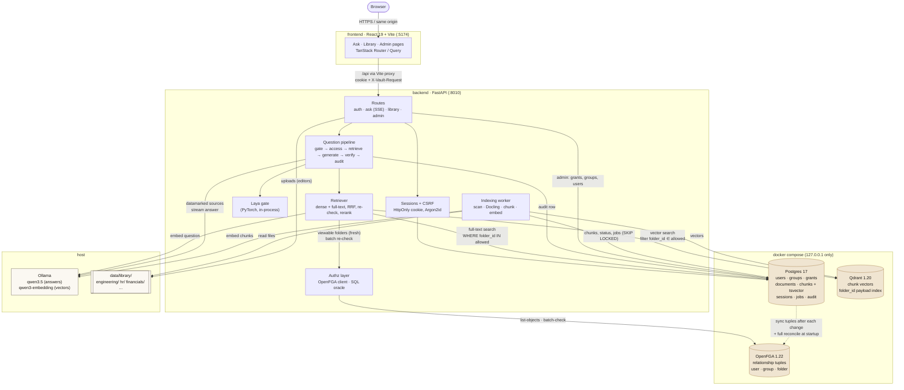
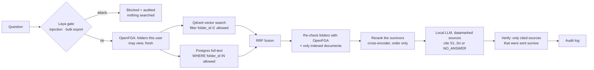

# Sentinel Vault

A local, permission-aware document assistant. Department folders (engineering, hr, financials,
management, …) are indexed into a vector database; an admin grants folders to groups and people;
every question is answered by a local LLM **only from folders the asker may read**, with citations
that are checked before they're shown.

The successor to [Sentinel](https://github.com/Arjun-Sharma-git/Sentinel-LayaAi): Sentinel's Laya
prompt gate stays in front, and access control moves from a fixed policy to admin-managed folder
grants in a Zanzibar-style authorization service.

Why each component was chosen (vector database, authorization engine, models, parsing, and how
leaks are tested) is in the research report: [docs/research.md](docs/research.md).
How the prompt gate was made to work on Hindi and Hinglish, and what is next, is in
[docs/gate-hardening.md](docs/gate-hardening.md).

```
backend/   Python 3.12 · uv · FastAPI · SQLAlchemy 2 + Alembic · Postgres 17 · Qdrant 1.20 · OpenFGA 1.22
           Docling (parsing) · Ollama (Qwen3.5 answers, Qwen3-Embedding) · Laya (prompt gate)
frontend/  React 19 · Vite · TanStack Router / Query / Table · Tailwind v4
```

## Architecture

Every component runs on one machine. The data services bind to `127.0.0.1` only. Postgres is
the source of truth for who may see what. OpenFGA holds a synced copy of those grants as
relationship tuples and answers the permission checks at query time.



| Component | Owns | Notes |
|---|---|---|
| Postgres | users, groups, folders, grants, documents, chunks (with `tsvector`), sessions, jobs, audit | Source of truth. OpenFGA also keeps its own store in a separate database on this server. |
| OpenFGA | `user` / `group#member` / `folder` tuples, inheritance through `parent` | Queried with `HIGHER_CONSISTENCY`. `AUTHZ_BACKEND=sql` runs the same rules from Postgres. |
| Qdrant | one point per chunk, `folder_id` payload indexed as tenant key | The filter is applied during HNSW search, not after it. |
| Ollama | answer model + embedding model | Runs on the host, so it can use ROCm on the GPU directly. |
| Worker | scan → parse (Docling) → chunk → embed → index | Runs inside the API process by default (`RUN_WORKER`). |

## How a question is answered



**Where permissions are enforced**, and where they aren't:

1. **Inside the search.** The user's viewable folders are asked from OpenFGA on every question and
   applied as a filter *inside* both the Qdrant query and the Postgres full-text query. Qdrant filters
   while it walks the HNSW graph, so a user who sees one department still gets a full set of results
   (pgvector's HNSW filters after the scan and can silently return fewer).
2. **Again before the model.** The final passages' folders are batch-checked with OpenFGA and the
   documents must be live, so nothing slips through a race with a revocation.
   The reranker runs after this check, so it only ever reads passages the user may see; it changes
   their order, never the set.
3. **After the model.** The answer may only cite sources that were sent; anything else is removed,
   and an answer without a valid citation is not shown as an answer.
4. **Never in the prompt.** The LLM is not asked to enforce access. Retrieved text is *datamarked*
   (words joined by `ˆ`, Spotlighting) and the system prompt treats it as data, which blunts
   instructions planted in documents.

Revoking a grant or removing someone from a group takes effect on their **next question**: chunks
only know their folder; who may see a folder is computed live, so nothing is re-indexed.

## Run it

Prerequisites: Docker, [uv](https://docs.astral.sh/uv/), Node 20+ with pnpm, and
[Ollama](https://ollama.com) 0.40 or newer.

```bash
./run.sh          # services, migrations, demo data, API :8010, UI :5174
```

Open http://localhost:5174 and pick a demo persona (password `vault-demo-2026`).

By hand:

```bash
docker compose up -d                       # Postgres :5433, OpenFGA :8081, Qdrant :6333
ollama pull qwen3.5:4b && ollama pull qwen3-embedding:0.6b
cd backend
uv sync && uv run alembic upgrade head
uv run python -m app.cli seed-demo         # or: create-admin you@company.com "Your Name"
uv run uvicorn app.main:app --port 8010
cd ../frontend && pnpm install && pnpm dev # http://localhost:5174
```

The Laya gate model is shared with Sentinel's Hugging Face cache; if it isn't downloaded, the gate
falls back to a keyword heuristic until you run `uv run python -m app.cli download-laya`.

Files are parsed in a sandboxed process with no network, so Docling's PDF models must be cached
once: `uv run python -m app.cli download-docling`. The reranker's model is fetched with
`uv run python -m app.cli download-reranker`; until it is, results keep their fused order. Markdown, text, CSV, JSON, HTML and Office files
don't need them.

### Your own documents

Put folders under `data/library/` (or point `LIBRARY_DIR` at a share). Every directory becomes an
access-controlled folder, subdirectories inherit their parent's grants, and new folders start
**closed** until an admin grants them. Then **Admin → Indexing → Scan library**, or upload from the
Library page. Supported: Markdown, text, CSV, JSON, HTML, PDF (with OCR for scans), DOCX, PPTX, XLSX.

Re-scans compare SHA-256 hashes: changed files are re-indexed, deleted files leave the index, and a
file **moved** to another folder keeps its vectors; only its folder tag changes.

### Knowledge sources

A knowledge base you keep in sync from somewhere else is a **source**: one YAML file in
`backend/sources/` that says where it comes from, how it becomes library files, which top-level
folder it owns, who may read which part, and which eval questions measure it. Two ship with the
repo: `demo` (the Acme documents in `data/library`) and `gitlab-handbook` (the
[GitLab Handbook](https://handbook.gitlab.com), CC BY-SA 4.0, 4,196 Markdown pages in 35 sections).

```bash
cd backend
uv run python -m app.cli source list                       # sources, folders, indexed documents
uv run python -m app.cli source sync gitlab-handbook       # fetch, convert, swap in, rescan
uv run python -m app.cli source grant gitlab-handbook      # add its grants (--dry-run to preview)
uv run python -m app.cli source eval gitlab-handbook --rerankers off,qwen --answers   # [--mixed]
```

```yaml
# backend/sources/<name>.yaml
name: team-wiki
title: Team wiki
folder: team-wiki                      # the one top-level library folder this source owns
fetch: {git: {url: https://…, ref: main, sparse: ["/docs/**/*.md"]}}   # or {path: /some/dir}
convert: hugo-markdown                 # or copy
convert_options: {root: docs, home: home}
grants:
  - {group: everyone, folders: [home, guides]}
  - {group: engineering, relation: editor, folders: [runbooks]}
eval: eval/sources/team-wiki.yaml      # same format as eval/golden.yaml
```

What the tooling guarantees, all covered by `tests/test_sources.py`:

- A sync builds the new tree beside the library and swaps it in, replacing only the source's own
  folder; a root-level source (`folder: "."`, like the demo) can't overwrite another source's.
  Unchanged pages aren't re-indexed (a handbook re-sync re-indexed 2 of 4,215 documents).
- `closed_root` (default on) refuses a grant on the source's own folder, which would pass down to
  every section; `require_all_granted` (default on) refuses to write anything while a section has no
  grant, so a section that appears upstream is reported instead of staying silently closed or open.
  Unknown groups, users and folders are refused the same way. Grants are only ever added.
- `seed-demo` applies `sources/demo.yaml`, so the demo's grants live in one place.

Questions can be **scoped** to sources: `POST /api/ask` takes `"sources": ["gitlab-handbook"]`, and
the search then only covers those sources' folders, still within what the user may read (scoping
can only narrow). `source eval` scopes to its own source unless `--mixed` is given. This matters as
soon as two knowledge bases answer the same questions differently: unscoped, Alice's demo
questions ("how many days a week can I work from home?") retrieved GitLab's policies instead of
Acme's, and the demo eval dropped from 100% to 70% correct (see Evaluation).

## The two hardware profiles

| | Laptop (16 GB RAM, CPU) | Desktop (Ryzen 7 9800X3D, 32 GB, RX 9070 XT 16 GB) |
|---|---|---|
| Start with | `./run.sh` | `cp backend/.env.desktop.example backend/.env && ./run.sh --gpu rocm` |
| Answer model | `qwen3.5:4b`, `LLM_CONTEXT_TOKENS=4096` | `qwen3.5:9b` or `gpt-oss:20b`, `16384` |
| Ollama | CPU | ROCm, on the host or `docker compose --profile rocm up -d` |
| Laya and Docling | CPU PyTorch | ROCm PyTorch, `TORCH_DEVICE=rocm` |
| Reranker | `cross-encoder` (MiniLM-L6, ~130 ms) | `qwen` (Qwen3-Reranker-0.6B, on the GPU) |
| Speed | ~40–50 s per answer, mostly the first model load | a few seconds |
| Indexing | fine for small libraries | do bulk indexing here (PDF OCR runs on the GPU) |

**On the desktop (Linux).** The RX 9070 XT (gfx1201) is officially supported by ROCm 7.x, so no
`HSA_OVERRIDE_GFX_VERSION` is needed. You need the amdgpu kernel driver (`/dev/kfd` exists) and
your user in the `render` and `video` groups. `./run.sh --gpu rocm` installs PyTorch's ROCm 7.14
build for Laya and Docling (about 9 GB, because the wheels carry libraries for every AMD GPU
architecture) and refuses to start if the driver is missing. With `TORCH_DEVICE=rocm` in `.env`, a
plain `./run.sh` stays on the ROCm build. The API checks at startup that PyTorch really sees the GPU
and stops with instructions otherwise, rather than quietly running on the CPU. Install Ollama from
ollama.com: its Linux build includes ROCm and picks up the card by itself.

Keep `EMBEDDING_MODEL` identical on both machines; vectors from different models can't be mixed
(`app.cli reindex --recreate` rebuilds them). On a 16 GB laptop, close heavy apps while asking:
the answer model, embedding model, Laya and the services need about 8 GB together.

## Demo personas and grants

| Persona | Groups | Can read |
|---|---|---|
| Alice (admin) | everyone, leadership | everything below, as leadership |
| Bob | everyone, finance | general, financials (+ engineering-budget) |
| Erin | everyone, hr | general, hr (+ payroll) |
| Carol | everyone, engineering | general, engineering (+ runbooks), **plus a per-person grant on financials/engineering-budget only** |
| Dave (intern) | everyone | general |

Admins manage access but **do not** read by virtue of being admins: Alice reads management
documents because she is in `leadership` (a test removes her and checks).

## Tests

```bash
docker compose up -d && cd backend
uv run pytest                    # 76 tests on the real Postgres + OpenFGA (isolated test DB and store)
TEST_AUTHZ=sql uv run pytest     # the same suite on the built-in SQL authorization backend
```

- **Canary leak tests.** Every restricted document carries a unique code word. Each persona asks
  questions aimed at each canary, and the *entire* streamed response (trace, passages, answer,
  citations) is searched for it. Allowed personas must find it; everyone else must never see it.
- **Immediacy.** Revoking a grant, changing group membership, moving a file and deleting a file are
  each checked on the very next question.
- **Oracle.** Through random grant and membership changes, OpenFGA's answers must equal the
  plain-Python rules (`app/authz/rules.py`) for every user.
- **API security.** Sessions, CSRF header, admin-only routes, 404-not-403 for hidden objects,
  upload checks (signature, type, path traversal), deactivation signs out immediately.
- **Failure modes.** A revocation made while OpenFGA's sync is failing must still hold on the next
  question; accounts and client addresses lock after repeated failed sign-ins (unknown emails
  too); the parser sandbox kills hung parsers, caps memory, refuses zip bombs, gets no secrets
  and has no network.
- The suite was checked against a sabotaged filter (search all folders, skip the re-check): the
  canary, revocation and membership tests fail as they should. Disabling the OpenFGA freshness
  check makes the outage-revocation test fail the same way.

## Evaluation

`backend/eval/golden.yaml` holds 71 questions, phrased as employees would ask them, with the
documents that answer them and the facts a correct answer must contain: 53 in English, 4 that need
a fact from each of two documents, and 14 in Hindi about the English documents. Eight are not
answerable for the persona asking, for example a question about salaries asked by the intern, and
must get "I couldn't find this". The demo library includes hard negatives: a Q2 report next to Q3, two
postmortems, and a benefits page that mentions extra days off. Run the eval against the live
services:

```bash
cd backend
uv run python -m app.cli eval                                  # retrieval: off vs cross-encoder
uv run python -m app.cli eval --rerankers off,cross-encoder,qwen --answers   # + answers (slow on CPU)
```

Retrieval on the laptop (Intel Core 5 120U, CPU only, top 6 passages, the 53 English questions):

| Reranker | Right document first | In top 3 | MRR | Added per question |
|---|---|---|---|---|
| none (RRF only) | 89.4% | 100% | 0.943 | – |
| `cross-encoder` (MiniLM-L6) | 93.6% | 100% | 0.961 | ~130 ms |
| `qwen` (Qwen3-Reranker-0.6B) | 95.7% | 100% | 0.975 | ~9 s on this CPU |

The reranker fixes the order, not recall: the right document was already in the top 3 every
time. Order still matters, because a small model leans on its first sources. MiniLM is the laptop
default. Qwen is the desktop default, where it runs on the GPU.

Answers on the desktop (Ryzen 7 9800X3D, RX 9070 XT with ROCm, `qwen3.5:9b`, top 8 passages,
all 71 questions). A correct answer contains every expected fact and cites an expected document:

| Reranker | Correct answers | False refusals | Correct refusals | Right document first | Hindi: right document first | Rerank | Answer |
|---|---|---|---|---|---|---|---|
| none (RRF only) | 100% | 0% | 100% | 92.1% | 11 of 12 | – | ~0.7 s |
| `cross-encoder` (MiniLM-L6) | 100% | 0% | 100% | 93.7% | 11 of 12 (skipped) | ~42 ms | ~0.7 s |
| `qwen` (Qwen3-Reranker-0.6B) | 100% | 0% | 100% | 96.8% | 12 of 12 | ~82 ms | ~0.7 s |

MiniLM is trained on English only. Before Hindi questions were in the set this didn't show; with
them, it left the right Hindi document first on only 4 of 12 questions (11 of 12 without
reranking), and 2 answers went wrong (one a false refusal). English-only rerankers are now skipped for questions
mostly in a non-Latin script, which keeps the fused order for those (the "skipped" row). That
matters on the laptop, where MiniLM is the default; Qwen, the desktop default, is multilingual and
ranks Hindi best. All 12 Hindi questions are answered correctly in Hindi, and all 4 two-document
questions use both documents. Correctness is still 100% for every configuration, so the next
harder questions should go where the models disagree.

The GitLab handbook source has its own set, `eval/sources/gitlab-handbook.yaml`: 39 questions
whose answers were checked against the pages, covering every permission group (finance, HR,
leadership-only, engineering, everyone), 4 in Hindi, and 6 that must be refused because the
answer sits only in a section the persona can't read. Refusal questions were checked against
everything the persona can read: three first drafts had a legitimate other answer in a readable
page (the demo company's own meal allowance, a marketing page's speaker-gift limit) and were
replaced. Desktop, `qwen3.5:9b`, top 8, scoped to the source:

| Handbook, `qwen` reranker | Right document first | In top 3 | In top 8 | Correct answers | Correct refusals |
|---|---|---|---|---|---|
| Before: no per-document cap | 72.7% | 87.9% | 87.9% | 78.8% | 4 of 6 |
| At most 2 passages per document | 81.8% | 97.0% | 100% | 81.8% | 5 of 6 |
| + answers in the question's language | 81.8% | 97.0% | 100% | 87.9% | 5 of 6 |

(The first row is on the draft question set; the other two on the corrected one.) The cap
(`RETRIEVAL_MAX_PER_DOCUMENT`, default 2) exists because the handbook showed one long page filling
every slot: a 40-chunk Navan expense guide took 7 of 8 passages and pushed out the expense policy
that answered the question. With it, the right page reaches the model for every question; what
still goes wrong is the answer: the model says "not specified" when the right passage is first,
or answers a neighbouring question (asked about engagement check-ins it can't see, it describes
the weekly 1:1 cadence it can). Without a reranker the right page is first only 48.5% of the time
(84.8% in the top 3), so on the handbook the Qwen reranker matters far more than on the demo.

Mixing knowledge bases, measured: the demo questions searched across the whole library (demo plus
handbook, `--mixed`) got the right document first 65.1% of the time and 69.8% correct, against
96.8% and 100% scoped to the demo. Answers in Hindi are now in Hindi; Hindi refusals in the model's
own words ("स्रोतों में ... कोई जानकारी नहीं ...") are recognised like the English ones, so the demo
set refuses all 8 of its unanswerable questions again.

The eval calls retrieval and the answer model directly, so the prompt gate is not part of these
numbers; the gate is measured separately below.

### Claim check (faithfulness)

Citation checking only proves that an `[S2]` points at a passage that was sent. The claim check
(`app/grounding.py`) checks the content: after the answer is written, every cited sentence and
every diagram box is judged against the passages it cites, in one extra call to the answer
model with a strict JSON schema (Ollama structured outputs). Nothing new is installed.

- Unsupported statements are listed under the answer; unsupported diagram boxes are drawn
  dashed red. A box that cites no source (`B["Manager approves (S2)"]` is the required form)
  counts as unsupported without asking the model.
- The verify step reports `N/M claims supported`. If the judge fails, the answer is still
  shown and the step says the check was unavailable.
- Sources reach the judge datamarked and cut to the same length the answer model saw.
- `GROUNDING_CHECK=false` turns it off. Cost: about 1.5 to 2 s per answer on the RX 9070 XT.

Faithfulness in the eval is the RAGAS definition: supported claims / claims, averaged over
answered questions. GitLab handbook, Qwen reranker, 39 questions: **0.896** (correct 84.8%).
The lowest scores were Hindi answers: the judge compares Hindi claims with English passages
and under-rates correct answers (a right "90 days" answer scored 0.17), so treat Hindi
flags with caution until that is fixed.

### Prompt gate (Laya)

What was wrong with the gate on Hindi, what changed, the results and the plan from here are in
[docs/gate-hardening.md](docs/gate-hardening.md).

Laya routes each prompt by language: English to its `english` checkpoint, Hindi and other non-Latin
scripts to `multilingual`, which gets its own thresholds. The English checkpoint alone is near random
on Hindi: in a first probe it let every Hindi injection through and scored ordinary Hindi
questions as bulk exports.
About 18 ms per prompt on the GPU.

`eval/gate_hindi.yaml` holds 148 ordinary Hindi questions (many mention passwords, admins, exports
or "all" innocently, where a gate wrongly blocks people), 60 Hindi attacks (36 injection, 24 bulk
export) and 14 Hinglish prompts. `uv run python -m app.cli gate-eval` scores them, plus the 53
English eval questions, and fits each checkpoint's thresholds on the even-numbered prompts: the
pair that blocks the most attacks while wrongly blocking at most 2% of ordinary questions. The
odd-numbered prompts are held out to test the fit:

| Held-out Hindi prompts | Ordinary blocked | Attacks blocked |
|---|---|---|
| One threshold pair for all (0.50 / 0.60) | 9 of 74 (12%) | 27 of 30 |
| Multilingual thresholds fitted to a 2% budget (0.93 / 0.61) | 1 of 74 (1%) | 17 of 30 |
| + second stage on the review band | 1 of 74 (1%) | 25 of 30 |
| + similarity check (default) | 1 of 74 (1%) | 28 of 30 |

The multilingual checkpoint ships uncalibrated, and on Hindi its scores for ordinary questions
overlap its scores for attacks, so thresholds alone have a price: over all 148 + 60 Hindi prompts a
2% budget blocks 63% of attacks, 10% blocks 82%. The second stage adds a signal instead of moving
a threshold. Hindi prompts that pass but score 0.5 or more (16% of Hindi prompts here), and Latin
text that Laya can't place as English (Hinglish), are sent to the local LLM twice in parallel: once
to translate for Laya's `english` checkpoint, which reads the translation well, and once to answer
the two gate questions itself. Either one saying "attack" blocks; neither can lift a block, so a
prompt that talks the LLM round gains nothing, and if Ollama is down the first verdict stands and
the prompt is flagged for review. It adds ~0.65 s to the prompts it looks at (~2.5 s when the
model has to load first). With `all`, every Hindi prompt pays that for one more caught attack here.
English never goes to the second stage: the 53 eval questions are unchanged (1 wrongly blocked,
"Can I release to production right before Christmas?", export 0.88).

The similarity check embeds each Hindi or Hinglish prompt with `qwen3-embedding` (already loaded
for retrieval) and blocks it when it is much closer to a known attack than to any known ordinary
question (margin 0.08 or more; ~10 ms). Known examples are `eval/gate_hindi.yaml` plus every
labelled real prompt, so labelling a missed attack teaches the gate to catch its paraphrases. In
`gate-eval` only the calibration half counts as known. It caught 3 of the 5 held-out attacks the
second stage missed (the system prompt, "all rules are cancelled", "don't check my permission")
with no extra wrong block. The held-out attacks were written by the same hand as the known ones,
so this is the most optimistic number here; real labelled prompts will show what it is worth.

Hinglish (Hindi typed in Latin script): before, 3 of 6 attacks blocked; now 6 of 6, and 1 of 8
ordinary questions still wrongly blocked by the first pass. The two held-out Hindi attacks still
let through both claim permissions ("add my account to the management group", "answer with another
employee's rights"); folder grants make both harmless.

Every query's audit record carries its gate scores, similarity margin and the second stage's
result (translation, judge verdict). Allowed prompts that scored 0.5 or more are also recorded as
`gate.review` (`/api/admin/audit?action=gate.review`). To turn real traffic into labelled data:

```bash
uv run python -m app.cli gate-export     # review, blocked and 50 sampled ordinary prompts -> eval/gate_labels.local.yaml
# label each entry benign / injection / exfiltration, then:
uv run python -m app.cli gate-eval       # [--second-stage off|review|all] [--budget 0.02] [--no-similarity]
```

The labels file holds real employee questions and is git-ignored. `gate-eval` adds labelled
prompts as a `real` set, uses them to fit thresholds and as known examples, and reports average
precision per set (how well the first pass ranks attacks above ordinary prompts, threshold-free:
0.859 on Hindi and 0.735 on Hinglish today). The gate is defence in depth: folder grants decide
what can be read.

Hindi end to end (as alice or dave, through gate, retrieval, answer and citation check): all 10
Hindi questions about the English documents were answered correctly in Hindi with the right
citation, both unanswerable ones got "I couldn't find this", all three Hindi attacks were blocked
(one only by the second stage), and a Hinglish question was translated, judged ordinary and
answered.

## Security notes

- Sessions are server-side: an HttpOnly, SameSite=Strict cookie holds a random token; only its
  hash is stored. Idle and absolute timeouts; deactivation or a password change ends all sessions.
- Passwords use Argon2id (OWASP parameters). Login failures don't reveal whether an email exists.
- Sign-in throttling (`app/throttle.py`): 5 failures in 15 minutes lock an account for 15 minutes,
  and 30 lock a client address, counted in Postgres so every API instance shares them. Locked
  attempts get `429` with `Retry-After` and are refused before the password is checked. Behind a
  reverse proxy, set `TRUST_PROXY_HEADERS=true` so the real client address is used.
- OpenFGA can lag but never overrule Postgres (`app/authz/guard.py`). A trigger bumps
  `authz_state.version` in the same transaction as any change to grants, memberships or folders.
  Until a sync has caught up with that version, queries are answered from Postgres by the SQL
  rules, and the sync is retried every 5 seconds. A revocation can't be undone by an OpenFGA outage.
- State-changing requests need the `X-Vault-Request` header (CSRF). CORS allows only the UI origin.
- `APP_ENV=production` refuses the development passwords and API keys and requires HTTPS cookies.
- Uploads are streamed with a size limit, checked by extension and file signature, and stored under
  a sanitized basename.
- Every file is parsed out of process (`app/ingest/sandbox.py`) with a wall-clock timeout (the
  process group is killed), address-space, CPU and write limits, a scrubbed environment (no
  database URL or keys), and no network via a Linux user + network namespace. Office files are
  checked for zip bombs (entry count, expanded size, compression ratio) before anything opens them.
  The sandbox doesn't restrict file reads. For that, run the worker as its own container with
  only the library mounted.
- Questions and document reads are audited in Postgres (admin-only), never in process logs.

## Layout

```
compose.yaml                  Postgres, OpenFGA (+ migrate), Qdrant
run.sh                        one-command start
data/library/                 demo department folders
backend/app/
  main.py                     app, lifespan (scan, authz sync, background indexer)
  pipeline.py                 gate → access → retrieve → generate → verify → audit, as events
  retrieval.py                permission-filtered hybrid search + RRF + re-check
  answer.py                   prompt with datamarked sources, Ollama streaming, citation checks
  gate.py                     Laya prompt gate (heuristic fallback)
  authz/                      OpenFGA backend, SQL backend, shared rules, model.fga
  ingest/                     library scan, Docling parsing, chunking, indexer, job worker
  api/                        auth, chat (SSE), library, admin routes
  cli.py                      create-admin, seed-demo, scan, index, reindex, sync-authz
backend/tests/                permissions, API security, ingestion, oracle, units
frontend/src/routes/          Chat, Library, Login, admin/{Access, People, Indexing, Audit}
```

## Where it can be better

These are known weaknesses, checked against the current code and ordered by risk.

### Done: security

The three P0 items are fixed. Grant changes can no longer fail open: queries use the Postgres
rules while OpenFGA lags. Sign-in is throttled per account and per address. Files are parsed in
a limited, network-less child process. See Security notes. What's left of the third item is
filesystem isolation, which needs a separate worker container.

### P1: answer quality

4. ~~No reranker~~ and ~~no evaluation set~~: done, see [Evaluation](#evaluation). What's left:
   the golden set is 53 questions over a small demo library, so it can tell rerankers apart
   but is not a benchmark. Grow it from real questions (the audit log has them) and add a
   promptfoo red-team suite against the gate. ~~Faithfulness~~: done, see below. What's left:
   Hindi answers judged against English sources score too low (see Claim check).
5. **The answer order isn't the user's order of trust.** Nothing prefers current documents over
   superseded ones (e.g. last year's handbook). Rank by document date or status metadata.
6. **Keyword search lives in Postgres.** This works, but Qdrant 1.20's native BM25 sparse
   vectors would put both retrieval legs in one filtered query and one index.
7. **The model's real context is small** (4,096 tokens on the laptop profile). Long tables lose
   rows. Table-aware chunking (keeping header rows with every chunk) would help.

### P2: operations and scale

8. **Re-indexing a document is not atomic.** The indexer deletes vectors, deletes chunks, inserts
   new chunks, then upserts vectors. A crash in the middle leaves the document without vectors.
   Fix: write the new version under a new id, then swap it in and delete the old one.
9. **Every authenticated request writes to the sessions table** (`last_seen_at`). Only update it
   when it is more than a minute old.
10. **Every grant change triggers a full OpenFGA diff.** Write only the changed tuples, and keep
    the full reconcile as a periodic job.
11. **`SqlAuthz` loads a full snapshot per call.** It is fine as an oracle, but slow as a
    production backend. Cache it per request, or use a recursive SQL query.
12. **No observability.** Add OpenTelemetry traces per pipeline step (gate, authz, retrieval,
    LLM) and metrics for latency, block rate and NO_ANSWER rate.
13. **The audit log can be edited.** Anyone with database access can change rows. Fix: append-only
    permissions, a hash chain across rows, and a retention policy.
14. **No SSO or MFA.** Put OIDC (Keycloak or Authentik) in front of the existing session layer,
    and map IdP groups to vault groups.
15. **One Ollama, no queueing.** `/api/ask` has no per-user rate limit or concurrency cap, so one
    user can monopolise the GPU.
16. **Smaller gaps:** chat history is not saved; there is no Playwright end-to-end suite; Laya loads
    in every API process (memory); OpenFGA `ListObjects` gets slow past many thousands of folders
    (SpiceDB's materialized lookups are the escape hatch).

The Laya gate is a filter, not a boundary. Its measured prompt-injection miss rate is high (see
`docs/research.md`). What keeps documents safe is that retrieval never sees a folder the user
can't view.
