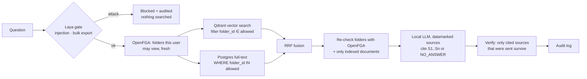

# Sentinel Vault

A local, permission-aware document assistant. Department folders (engineering, hr, financials,
management, …) are indexed into a vector database; an admin grants folders to groups and people;
every question is answered by a local LLM **only from folders the asker may read**, with citations
that are checked before they're shown.

The successor to [Sentinel](https://github.com/Arjun-Sharma-git/Sentinel-LayaAi): Sentinel's Laya
prompt gate stays in front, and access control moves from a fixed policy to admin-managed folder
grants in a Zanzibar-style authorization service.

```
backend/   Python 3.12 · uv · FastAPI · SQLAlchemy 2 + Alembic · Postgres 17 · Qdrant 1.20 · OpenFGA 1.22
           Docling (parsing) · Ollama (Qwen3.5 answers, Qwen3-Embedding) · Laya (prompt gate)
frontend/  React 19 · Vite · TanStack Router / Query / Table · Tailwind v4
```

## How a question is answered



**Where permissions are enforced**, and where they aren't:

1. **Inside the search.** The user's viewable folders are asked from OpenFGA on every question and
   applied as a filter *inside* both the Qdrant query and the Postgres full-text query. Qdrant filters
   while it walks the HNSW graph, so a user who sees one department still gets a full set of results
   (pgvector's HNSW filters after the scan and can silently return fewer).
2. **Again before the model.** The final passages' folders are batch-checked with OpenFGA and the
   documents must be live, so nothing slips through a race with a revocation.
3. **After the model.** The answer may only cite sources that were sent; anything else is removed,
   and an answer without a valid citation is not shown as an answer.
4. **Never in the prompt.** The LLM is not asked to enforce access. Retrieved text is *datamarked*
   (words joined by `ˆ`, Spotlighting) and the system prompt treats it as data, which blunts
   instructions planted in documents.

Revoking a grant or removing someone from a group takes effect on their **next question**: chunks
only know their folder; who may see a folder is computed live, so nothing is re-indexed.

## Run it

Prerequisites: Docker, [uv](https://docs.astral.sh/uv/), Node 20+ with pnpm, and
[Ollama](https://ollama.com) 0.40 or newer.

```bash
./run.sh          # services, migrations, demo data, API :8010, UI :5174
```

Open http://localhost:5174 and pick a demo persona (password `vault-demo-2026`).

By hand:

```bash
docker compose up -d                       # Postgres :5433, OpenFGA :8081, Qdrant :6333
ollama pull qwen3.5:4b && ollama pull qwen3-embedding:0.6b
cd backend
uv sync && uv run alembic upgrade head
uv run python -m app.cli seed-demo         # or: create-admin you@company.com "Your Name"
uv run uvicorn app.main:app --port 8010
cd ../frontend && pnpm install && pnpm dev # http://localhost:5174
```

The Laya gate model is shared with Sentinel's Hugging Face cache; if it isn't downloaded, the gate
falls back to a keyword heuristic until you run `uv run python -m app.cli download-laya`.

### Your own documents

Put folders under `data/library/` (or point `LIBRARY_DIR` at a share). Every directory becomes an
access-controlled folder, subdirectories inherit their parent's grants, and new folders start
**closed** until an admin grants them. Then **Admin → Indexing → Scan library**, or upload from the
Library page. Supported: Markdown, text, CSV, JSON, HTML, PDF (with OCR for scans), DOCX, PPTX, XLSX.

Re-scans compare SHA-256 hashes: changed files are re-indexed, deleted files leave the index, and a
file **moved** to another folder keeps its vectors; only its folder tag changes.

## The two hardware profiles

| | Laptop (16 GB RAM, CPU) | Desktop (Ryzen 7 9800X3D, 32 GB, RX 9070 XT 16 GB) |
|---|---|---|
| Answer model | `qwen3.5:4b`, `LLM_CONTEXT_TOKENS=4096` | `qwen3.5:9b` or `gpt-oss:20b`, `16384` |
| Ollama | CPU | ROCm (Linux), e.g. `ollama/ollama:rocm` with `/dev/kfd` and `/dev/dri` |
| Speed | ~40–50 s per answer, mostly the first model load | a few seconds |
| Indexing | fine for small libraries | do bulk indexing here |

Keep `EMBEDDING_MODEL` identical on both machines; vectors from different models can't be mixed
(`app.cli reindex --recreate` rebuilds them). On a 16 GB laptop, close heavy apps while asking:
the answer model, embedding model, Laya and the services need about 8 GB together.

## Demo personas and grants

| Persona | Groups | Can read |
|---|---|---|
| Alice (admin) | everyone, leadership | everything below, as leadership |
| Bob | everyone, finance | general, financials (+ engineering-budget) |
| Erin | everyone, hr | general, hr (+ payroll) |
| Carol | everyone, engineering | general, engineering (+ runbooks), **plus a per-person grant on financials/engineering-budget only** |
| Dave (intern) | everyone | general |

Admins manage access but **do not** read by virtue of being admins: Alice reads management
documents because she is in `leadership` (a test removes her and checks).

## Tests

```bash
docker compose up -d && cd backend
uv run pytest                    # 53 tests on the real Postgres + OpenFGA (isolated test DB and store)
TEST_AUTHZ=sql uv run pytest     # the same suite on the built-in SQL authorization backend
```

- **Canary leak tests.** Every restricted document carries a unique code word. Each persona asks
  questions aimed at each canary, and the *entire* streamed response (trace, passages, answer,
  citations) is searched for it. Allowed personas must find it; everyone else must never see it.
- **Immediacy.** Revoking a grant, changing group membership, moving a file and deleting a file are
  each checked on the very next question.
- **Oracle.** Through random grant and membership changes, OpenFGA's answers must equal the
  plain-Python rules (`app/authz/rules.py`) for every user.
- **API security.** Sessions, CSRF header, admin-only routes, 404-not-403 for hidden objects,
  upload checks (signature, type, path traversal), deactivation signs out immediately.
- The suite was checked against a sabotaged filter (search all folders, skip the re-check): the
  canary, revocation and membership tests fail as they should.

## Security notes

- Sessions are server-side: an HttpOnly, SameSite=Strict cookie holds a random token; only its
  hash is stored. Idle and absolute timeouts; deactivation or a password change ends all sessions.
- Passwords use Argon2id (OWASP parameters). Login failures don't reveal whether an email exists.
- State-changing requests need the `X-Vault-Request` header (CSRF). CORS allows only the UI origin.
- `APP_ENV=production` refuses the development passwords and API keys and requires HTTPS cookies.
- Uploads are streamed with a size limit, checked by extension and file signature, stored under a
  sanitized basename, and parsed by Docling with page limits.
- Questions and document reads are audited in Postgres (admin-only), never in process logs.

## Layout

```
compose.yaml                  Postgres, OpenFGA (+ migrate), Qdrant
run.sh                        one-command start
data/library/                 demo department folders
backend/app/
  main.py                     app, lifespan (scan, authz sync, background indexer)
  pipeline.py                 gate → access → retrieve → generate → verify → audit, as events
  retrieval.py                permission-filtered hybrid search + RRF + re-check
  answer.py                   prompt with datamarked sources, Ollama streaming, citation checks
  gate.py                     Laya prompt gate (heuristic fallback)
  authz/                      OpenFGA backend, SQL backend, shared rules, model.fga
  ingest/                     library scan, Docling parsing, chunking, indexer, job worker
  api/                        auth, chat (SSE), library, admin routes
  cli.py                      create-admin, seed-demo, scan, index, reindex, sync-authz
backend/tests/                permissions, API security, ingestion, oracle, units
frontend/src/routes/          Chat, Library, Login, admin/{Access, People, Indexing, Audit}
```

## Limits and next steps

- OpenFGA's `ListObjects` is fine for hundreds of folders; at many thousands, keep the per-query
  folder set small (e.g. cache per request) or move to SpiceDB's materialized lookups.
- Single-node. For several API instances, run the indexer as its own worker process
  (`RUN_WORKER=false` on the API) — the job queue already uses `SKIP LOCKED`.
- No reranker yet (Qwen3-Reranker-0.6B is the planned addition), and no OIDC: add an identity
  provider (Keycloak, Authentik) behind the existing session layer for SSO.
- The answer quality of 4B models on long or tabular documents is the main open risk; the
  desktop profile (9B–20B on the RX 9070 XT) is the intended setup for daily use.
